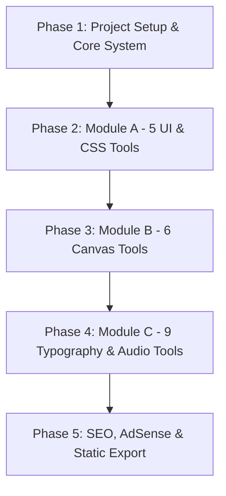

# 🛠️ DesignStyleForge — Master Implementation Plan

> **Objective:** Build a lightning-fast, static Next.js 15+ frontend utility platform (`DesignStyleForge`) hosting 20+ specialized design style generators, canvas editors, and typography tools with **₹0 infrastructure cost**, **high Google AdSense yield**, and **deep SEO compliance**.

---

## 1. Architectural Foundations & Technology Decisions

### 1.1 Core Stack & Configuration
| Layer | Choice | Rationale |
| :--- | :--- | :--- |
| **Framework** | Next.js 15+ (App Router) | Static export (`output: 'export'`), instant client routing, built-in metadata & font optimization. |
| **Language** | TypeScript | Strong typing for canvas operations, CSS property generators, and tool presets. |
| **Styling** | Tailwind CSS + CSS Variables | Fast prototyping, custom utilities, theme tokens, `@tailwindcss/typography` for rich SEO articles. |
| **Icons** | Lucide React | Lightweight, tree-shakeable icons for controls, copy buttons, and downloads. |
| **Canvas & Media** | HTML5 Canvas API + Web Audio API | Zero external server dependencies; client-side image/audio manipulation. |
| **Local Persistence** | `localStorage` | Preserves user preferences, custom presets, and theme toggle without a database. |
| **Export Target** | Static Site Generation (SSG) | Compatible with Vercel, Netlify, and Cloudflare Pages Free Tiers with zero cold-start delay. |

### 1.2 Configuration Specifics
- `next.config.mjs` / `next.config.ts`:
  ```js
  /** @type {import('next').NextConfig} */
  const nextConfig = {
    output: 'export',
    images: { unoptimized: true },
    trailingSlash: true,
  };
  ```
- **Font Strategy:** `next/font/google` loading Inter/Outfit (Primary UI) and JetBrains Mono (Code/CSS outputs) with `display: 'swap'`.

---

## 2. Layout & Monetization Architecture (AdSense & SEO Optimized)

To guarantee Google AdSense approval and maximize CTR / Time-on-Site:

```
+--------------------------------------------------------------------------+
|  HEADER: Brand Logo  |  Search / Quick Filter  |  Theme Toggle  |  GitHub  |
+--------------------------------------------------------------------------+
|  [AdSlot: Top Leaderboard Banner - 728x90 / Responsive]                 |
+------------------------------------+-------------------------------------+
|  TOOL INTERFACE (Interactive)      |  LIVE PREVIEW & CODE OUTPUT         |
|  - Sliders & Color Pickers         |  - Real-time Interactive Box / Canvas|
|  - Preset Selectors                |  - Format Switcher (CSS, Tailwind)  |
|  - Dimension / Granularity options |  - 1-Click Copy & Download Buttons  |
+------------------------------------+-------------------------------------+
|  [AdSlot: High-CTR In-Feed Ad - Placed right below Code Output / Action]  |
+--------------------------------------------------------------------------+
|  SEO ARTICLE & EDUCATIONAL GUIDE (Min 400-600 words per tool page)       |
|  - <h2> What is [Style Name]? History & Evolution                       |
|  - <h3> How [Style] Works in Modern CSS / Canvas                         |
|  - <h3> Best Practices, Browser Compatibility & Accessibility            |
|  - <h3> Interactive FAQ Accordion (with FAQPage JSON-LD Schema)          |
+--------------------------------------------------------------------------+
|  FOOTER: Related Tools Grid  |  Privacy Policy  |  Terms  |  About       |
|  [AdSlot: Sticky Anchor Ad on Mobile Viewports]                          |
+--------------------------------------------------------------------------+
```

### 2.1 Standardized `ToolLayout` Component
Every single tool page will leverage a shared `ToolLayout` providing:
1. **Breadcrumbs Navigation:** `Home > Tools > [Tool Name]` (with BreadcrumbList schema).
2. **Hero Section:** Clear `H1`, concise subtitle, tag badges (e.g., `CSS Generator`, `Client-Side`, `Free`).
3. **Workspace Grid:** Two-column responsive split (Control Panel + Live Preview).
4. **Action Bar:** Copy CSS, Copy Tailwind, Download Image/HTML, Reset to defaults, Share Preset.
5. **AdSense Placements:** Configurable ad wrappers with test placeholders in development and live script injection ready for production `data-ad-client`.
6. **SEO Deep-Dive Article:** Dedicated semantic `<article>` with rich typography, code snippets, compatibility tables, and FAQ accordions.
7. **JSON-LD Structured Data:** `SoftwareApplication` and `FAQPage` schemas injected automatically.

---

## 3. Comprehensive Tool Matrix (All 20 Tools Detailed)

### Module A: UI & CSS Generators (High Conversion)
| Route | Tool Name | Core Interactive Controls | Output Formats | SEO Guide Subject |
| :--- | :--- | :--- | :--- | :--- |
| `/tools/glassmorphism` | **Frosted Glass Builder** | Blur (px), Opacity (%), Border Radius, Border Opacity, Tint Color, Reflection Highlight | CSS (`backdrop-filter`), Tailwind classes, Live Card Preview | Fluent Design, browser support for backdrop-filter, performance caveats. |
| `/tools/cyberpunk` | **Neon Glitch Text Gen** | Text input, Glow intensity, Neon color 1 & 2, Glitch speed, Text shadow offset | CSS Keyframes + HTML snippet, Copy button | History of Cyberpunk UI, scanlines, SVG filters vs CSS keyframes. |
| `/tools/claymorphism` | **3D Clay Button Builder** | Base color, Corner radius, Inset shadow depth, Outer shadow blur, Light source angle | Pure CSS shadow stack, Tailwind classes | Claymorphism vs Neumorphism, accessibility & contrast, light source physics. |
| `/tools/aurora` | **Aurora Gradient Canvas** | 4-color mesh picker, animation speed, blur spread, noise texture overlay toggle | CSS radial-gradient mesh code, animated keyframes | Northern Lights UI design, modern mesh gradients, hardware acceleration. |
| `/tools/minimalism` | **Bio-Link Customizer** | Avatar image upload, name, bio, 5 custom links, font family selector, card border style | Standalone HTML/CSS single-file bundle download | Minimalist design principles, Linktree alternatives, page speed optimization. |

### Module B: Canvas & Image Processing (High Engagement)
| Route | Tool Name | Core Interactive Controls | Output Formats | SEO Guide Subject |
| :--- | :--- | :--- | :--- | :--- |
| `/tools/pixel-art` | **Grid Pixel Painter** | 8x8 / 16x16 / 32x32 grid, Color palette picker, Pencil, Eraser, Fill bucket, Grid lines toggle | PNG export (scaled x16 crisp pixel rendering) | Pixel art in modern web, 8-bit aesthetic, canvas image-rendering pixelated. |
| `/tools/retro` | **CRT Scanline Simulator** | Image upload, Scanline density, CRT curvature/distortion, Phosphor bloom, Vignette, Flicker | Processed high-res PNG / JPEG | Retro CRT monitor mechanics, phosphor glow emulation in Canvas 2D. |
| `/tools/pop-art` | **Halftone Comic Filter** | Image upload, Dot radius, Angle, CMYK vs Monochrome mode, Contrast threshold | High-res Comic Pop-Art PNG | Roy Lichtenstein pop art, halftone printing technology, image rasterization. |
| `/tools/collage-art` | **Vintage Element Mixer** | Canvas with draggable, scalable, rotatable vintage stickers/textures (cutouts, paper, stamps) | Flattened Composite PNG artwork | Dadaism & Punk collage aesthetics, layered canvas rendering techniques. |
| `/tools/editorial` | **Magazine Cover Maker** | Image upload, Magazine Title (Vogue/Time style), Issue date, Headlines, Barcode position | High-res Magazine Cover PNG | Editorial typography, grid hierarchy in publishing, focal points in portrait layouts. |
| `/tools/surreal-art` | **Dreamscape Element Mixer** | Canvas with surreal elements (floating eyes, celestial ladders, clouds, melting shapes), blend modes | Artwork PNG export | Surrealism in digital design (Dali/Magritte influence), dreamlike compositing. |

### Module C: Typography, Layout & Audio (Niche Traffic & Retention)
| Route | Tool Name | Core Interactive Controls | Output Formats | SEO Guide Subject |
| :--- | :--- | :--- | :--- | :--- |
| `/tools/maximalism` | **Chaos Collage Board** | Randomizer button, chaotic stickers, clash color palette, sticker density slider | Downloadable chaotic poster image | Maximalism vs Minimalism ("More is More"), anti-design trends in web. |
| `/tools/futuristic` | **Sci-Fi HUD Simulator** | Live clock, rotating radar sweep, telemetry bars, targeting reticles, Sci-Fi sound toggle | Fullscreen interactive HUD + CSS animation snippet | HUD design in video games & movies, CSS transforms, SVG animations. |
| `/tools/vector-art` | **SVG Path Combiner** | Two SVG input boxes / presets, Union / Intersect / Difference blend preview, Stroke width | Merged clean SVG path code + Download SVG | SVG path commands (M, C, Z), vector optimization, boolean path operations. |
| `/tools/y2k` | **Winamp Retro Skin Player** | Audio file upload (Web Audio API), EQ visualizer bars, retro metal/neon skin, pitch/volume | Interactive playable retro widget | Y2K aesthetic resurgence, skeuomorphism, Web Audio API frequency analysis. |
| `/tools/swiss-design` | **Bold Poster Maker** | Asymmetrical grid selector, Helvetica bold headlines, color accent (Red/Black/White), framing rule | Print-ready PNG / SVG poster | International Typographic Style (Swiss Style), grid systems, Josef Müller-Brockmann. |
| `/tools/bohemian` | **Earthy Palette Generator** | 5-color terracotta/sage/ochre generator, spacebar randomize, lock color, hex/rgb/hsl copy | CSS variables, Tailwind config snippet, PNG swatch | Bohemian color theory, organic & earthy hues in modern branding. |
| `/tools/victorian` | **Monogram Border Gen** | Monogram initial(s), ornate vintage frame selector, flourish density, antique tint | SVG & PNG ornate stamp / seal | Victorian typography, copperplate engravings, heraldry design rules. |
| `/tools/graffiti` | **Spray Paint Canvas** | Spray radius, drip frequency, neon spray colors, stencil overlay, splatter pressure | High-res Street Art PNG | Street art aesthetics, procedural particle drip simulation on HTML5 canvas. |
| `/tools/handwritten` | **Font Previewer** | Text input, cursive & calligraphy font selector, slant angle, ink bleed, baseline jitter | PNG stamp or CSS `@font-face` / Google font embed | Psychology of handwritten fonts, organic branding, web typography pairing. |

---

## 4. Phased Execution Roadmap



### **Phase 1: Foundation & Global Systems**
1. **Initialize Project:** Next.js 15+ App Router with TypeScript, Tailwind CSS, Lucide icons, `@tailwindcss/typography`.
2. **Setup Static Export:** Configure `next.config.ts` (`output: 'export'`, `trailingSlash: true`, `images: { unoptimized: true }`).
3. **Design System & Layout:**
   - Global Navigation (Header with search, categories, dark/light mode toggle).
   - Global Footer (Legal links, privacy policy, disclaimer for AdSense readiness).
   - Reusable `ToolLayout` with slot architecture (Controls, Preview, Code Box, Ad Slots, SEO Article).
   - Reusable `AdSenseSlot` component with fallback testing placeholders.
   - Reusable `JsonLd` component for rich snippets.
4. **Homepage & Catalog:**
   - Searchable, filterable directory of all 20 tools with badges and live mini-previews.
   - Category filters (CSS Generators, Canvas Editors, Typography & Audio).

### **Phase 2: Module A — 5 UI & CSS Generators**
1. Frosted Glass Builder (`/tools/glassmorphism`)
2. Neon Glitch Text Gen (`/tools/cyberpunk`)
3. 3D Clay Button Builder (`/tools/claymorphism`)
4. Aurora Gradient Canvas (`/tools/aurora`)
5. Bio-Link Customizer (`/tools/minimalism`)
*Each complete with interactive UI, real-time code output, copy feedback, and 400+ words SEO article.*

### **Phase 3: Module B — 6 Canvas & Image Processing Tools**
1. Grid Pixel Painter (`/tools/pixel-art`)
2. CRT Scanline Simulator (`/tools/retro`)
3. Halftone Comic Filter (`/tools/pop-art`)
4. Vintage Element Mixer (`/tools/collage-art`)
5. Magazine Cover Maker (`/tools/editorial`)
6. Dreamscape Element Mixer (`/tools/surreal-art`)
*Each complete with client-side canvas processing, image upload/export, and in-depth educational guide.*

### **Phase 4: Module C — 9 Typography, Layout & Audio Tools**
1. Chaos Collage Board (`/tools/maximalism`)
2. Sci-Fi HUD Simulator (`/tools/futuristic`)
3. SVG Path Combiner (`/tools/vector-art`)
4. Winamp Retro Skin Player (`/tools/y2k`)
5. Bold Poster Maker (`/tools/swiss-design`)
6. Earthy Palette Generator (`/tools/bohemian`)
7. Monogram Border Gen (`/tools/victorian`)
8. Spray Paint Canvas (`/tools/graffiti`)
9. Font Previewer (`/tools/handwritten`)

### **Phase 5: SEO, AdSense Integration & Production Build**
1. Generate static `sitemap.xml` and `robots.txt`.
2. Add comprehensive Privacy Policy, Terms of Service, and About Us pages (mandatory for Google AdSense approval).
3. Validate static site export via `npm run build` and ensure zero SSG errors.
4. Verify sub-second load times and high responsive design standards.

---

## 5. AdSense Compliance & Approval Checklist

- [x] **Zero Blank/Thin Pages:** Every single tool has functional utility + 400+ words of unique, high-quality educational text.
- [x] **Mandatory Legal Pages:** `/privacy-policy`, `/terms`, `/about`, `/contact`.
- [x] **Ad Placement Safety:** Clear separation between ads and interactive controls to prevent accidental clicks (AdSense policy violation).
- [x] **Clear Value Proposition:** High utility, high session duration (interactive canvas/generators keep users engaged > 2 minutes).
- [x] **Valid HTML & Schema:** Clean markup, standard meta tags, OpenGraph images, and structured JSON-LD data.
